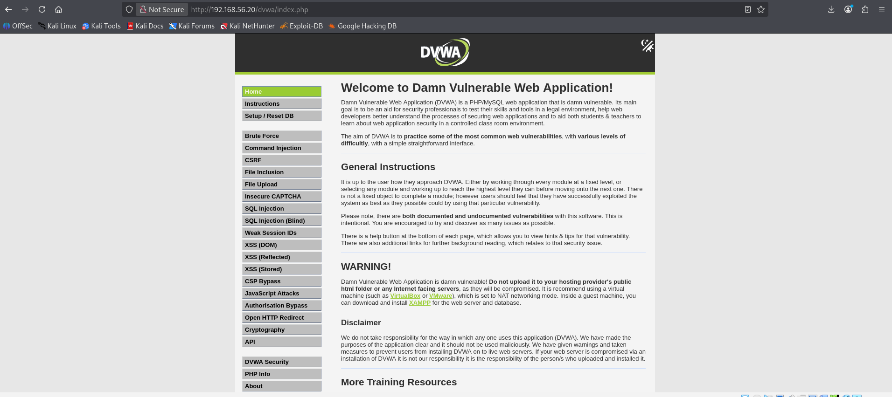
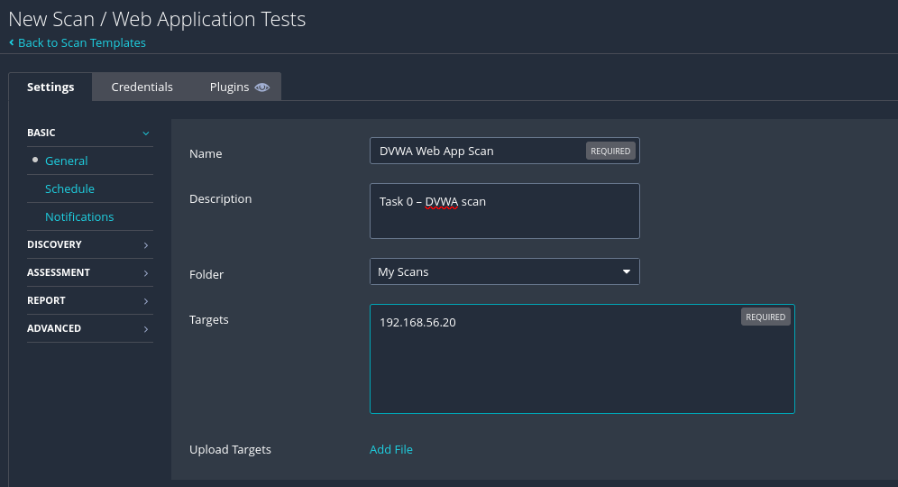
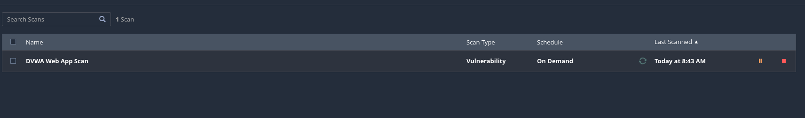
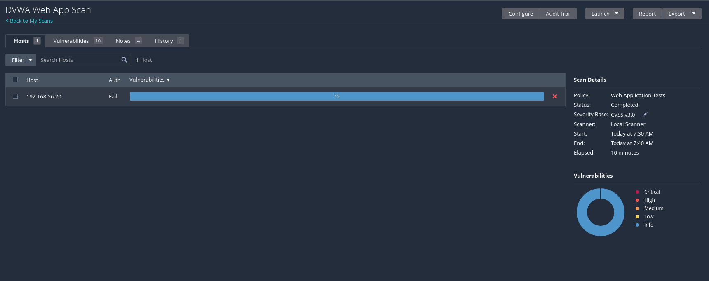
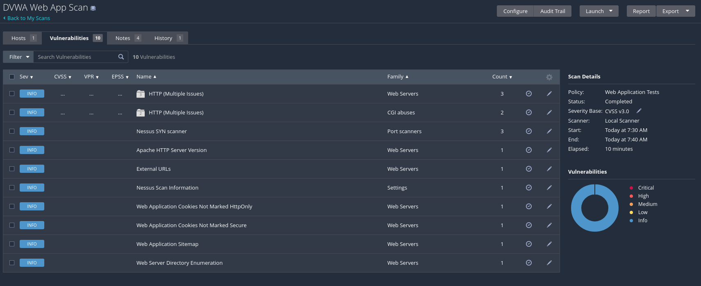
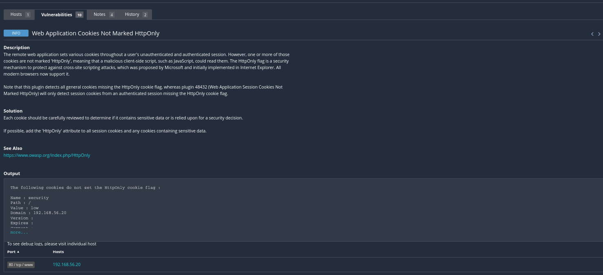
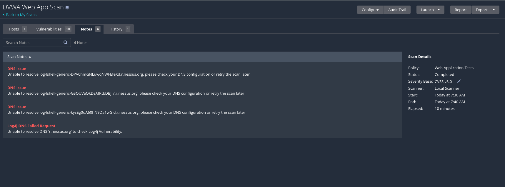
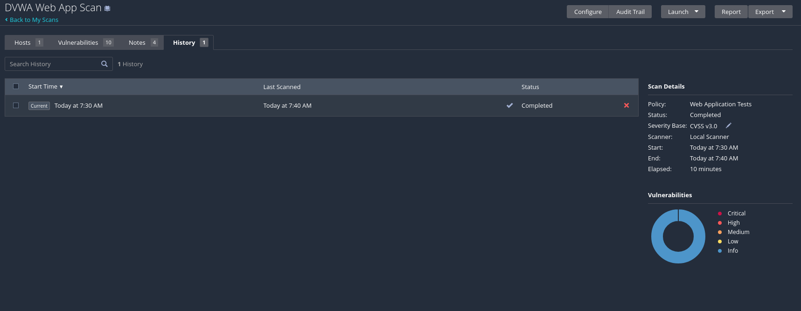

# 0. Web Application Scan on DVWA

**Objective:** Use Nessus Essentials to scan an intentionally vulnerable web application hosted in your lab, then analyse the results.

## Background

Imagine you are responsible for securing a web application. Before attackers find the weaknesses, it is your job to discover them first. In this task I used **Nessus Essentials** with the **Web Application Tests** template to scan **DVWA** (Damn Vulnerable Web Application) — an intentionally vulnerable web application installed on the Ubuntu Server VM.

## Lab Information

| Field | Value |
|-------|-------|
| Scanner | Nessus Essentials on Kali Linux (192.168.56.10) |
| Target | DVWA on Ubuntu Server (192.168.56.20) |
| Target URL | http://192.168.56.20/dvwa |
| Nessus Template | Web Application Tests |

---

## Section 1 - Preparing DVWA

**Steps**

1. Open the web browser on Kali Linux.
2. Navigate to the DVWA URL (`http://192.168.56.20/dvwa`).
3. Log in to the application (`admin` / `password`).
4. Initialize or reset the DVWA database if required (Setup / Reset DB page).
5. Log in again after reset.
6. Set DVWA security level to **Low**.

**Screenshot required: DVWA dashboard after login**



---

## Section 2 - Scan Configuration

**Steps in Nessus**

1. Access Nessus web interface (`https://localhost:8834`).
2. Create a new scan.
3. Select **Web Application Tests** template.
4. Configure scan settings (name, target, authentication cookie).
5. Save the scan configuration.

**Screenshot required: Scan configuration page**



### Scan Settings Record

| Setting | Value |
|---------|-------|
| Scan Name | DVWA Web App Scan |
| Target URL | http://192.168.56.20 (target `192.168.56.20`) |
| Scan Type | Web Application Tests |
| Port Range | Default (port 80) |

> **Authentication note:** DVWA sits behind a login, so an HTTP cookie (`PHPSESSID` + `security=low`) was supplied to Nessus via a Netscape-format cookie file (`dvwa-cookies.txt`) under the scan's Credentials tab, so the scanner could reach pages behind the login.

---

## Section 3 - Scan Execution

**Steps**

1. Launch the scan.
2. Monitor scan progress.
3. Wait until scan completion.

**Screenshot required: Scan running status**



**Screenshot required: Scan completed status**



### Scan Monitoring Record

| Metric | Value |
|--------|-------|
| Start Time | 07:30 |
| End Time | 07:40 |
| Duration | 10 minutes |
| Status | Completed |

---

## Section 4 - Results Analysis

### 4.1 Vulnerability Overview

| Severity | Count |
|----------|-------|
| Critical | 0 |
| High | 0 |
| Medium | 0 |
| Low | 0 |
| Informational | 10 |
| **Total** | **10** |

**Screenshot required: Nessus severity summary**


### 4.2 Critical and High Vulnerabilities

| # | Vulnerability Name | Severity | CVE | Service |
|---|--------------------|----------|-----|---------|
| 1 | None found | - | - | - |
| 2 | None found | - | - | - |
| 3 | None found | - | - | - |
| 4 | None found | - | - | - |
| 5 | None found | - | - | - |

> **Analysis:** The Web Application Tests scan returned **no Critical or High findings** — all 10 results were Informational. Two reasons explain this:
> 1. DVWA's deliberate vulnerabilities (SQL injection, XSS, command injection) are *application-logic* flaws. A general-purpose scanner such as Nessus does not flag them at high severity; they are identified through manual testing or tools such as Burp Suite.
> 2. The authenticated session reported `Auth: Fail` on the host, so Nessus assessed mainly the public-facing surface (web-server configuration, cookie flags, directory listing) rather than the deeper authenticated content.

**Screenshot required: Filtered vulnerability list (Critical/High)**



### 4.3 Deep Dive - One Vulnerability

| Field | Detail |
|-------|--------|
| Plugin Name | Web Application Cookies Not Marked HttpOnly |
| CVE ID | N/A (no CVE assigned) |
| Plugin ID | 49218 *(confirm in the Plugin Details panel)* |
| Plugin Family | Web Servers |
| Severity | Informational |
| CVSS Score | N/A (0.0) |
| Affected Host | 192.168.56.20 |
| Port / Service | 80 / tcp / www |
| Synopsis | HTTP cookies set by the web application are missing the `HttpOnly` flag. |
| Description | The remote web application sets various cookies during a user's unauthenticated and authenticated session. One or more of those cookies are not marked `HttpOnly`, meaning a malicious client-side script (e.g. JavaScript) could read them. The `HttpOnly` flag is a security mechanism that protects against cross-site scripting attacks. |
| Impact | If the application contains a cross-site scripting (XSS) flaw, an attacker's script could read the session cookie and hijack the user's session. |
| Remediation | Review each cookie for sensitive data, and add the `HttpOnly` attribute to all session cookies and any cookies containing sensitive data. |
| References | https://www.owasp.org/index.php/HttpOnly ; CWE-1004 |

**Plugin Output (observed):**

```
The following cookies do not set the HttpOnly cookie flag :

Name   : security
Path   : /
Value  : low
Domain : 192.168.56.20
```

**Screenshot required: Vulnerability detail page**



---

## Section 5 - Report Export

**Steps**

1. Open scan results.
2. Select report export option (**Report** / **Export**).
3. Choose **PDF** format.
4. Generate and download report.

**Screenshot required: Report export screen**

> _TODO: add `img/task0/10-report-export.png` — open the scan, click **Report** (or **Export**), choose **PDF**, and screenshot the export dialog. Then download the PDF and submit it alongside this document._

---

## Supporting screenshots

**Scan Notes** (the DNS-resolution notes are Nessus trying to reach `r.nessus.org` for Log4Shell checks with no internet — harmless):



**Scan History:**



---

## Submission Checklist

- [x] DVWA prepared and accessible
- [x] Scan configured
- [x] Scan executed successfully
- [x] Scan monitoring data completed
- [x] Vulnerability summary filled
- [x] Critical/High table completed (none found — explained)
- [x] Deep dive section completed
- [ ] Nessus report exported (PDF) — _export the PDF and add the Section 5 screenshot_
- [ ] All required screenshots included — _pending the Section 5 report-export screenshot_
