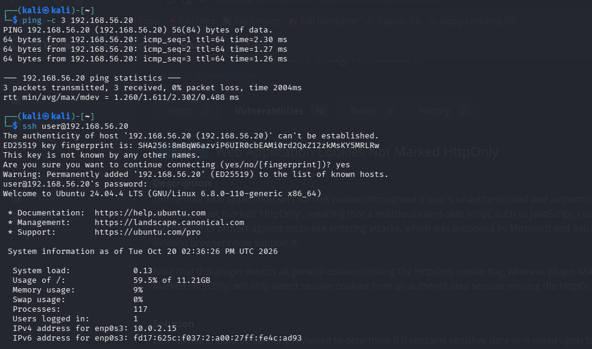
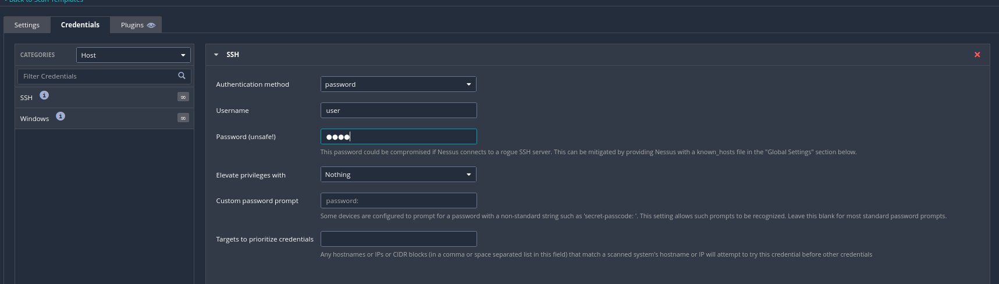
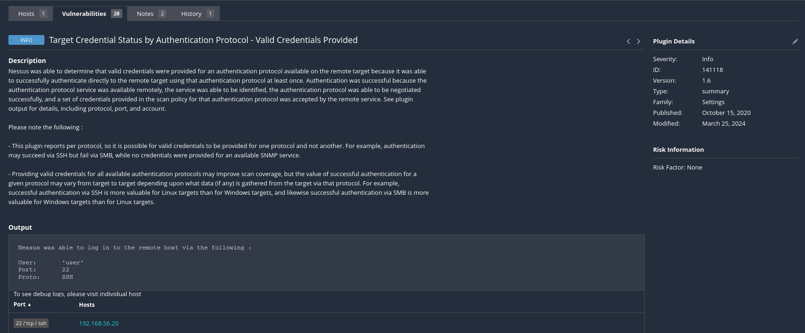
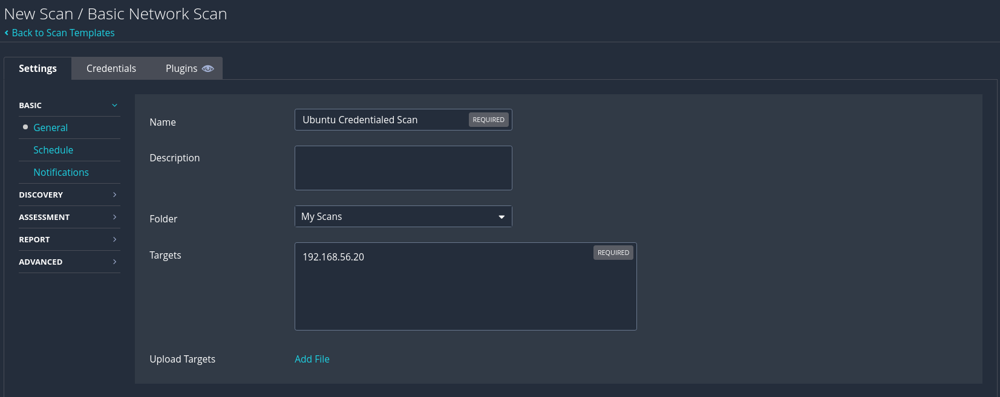
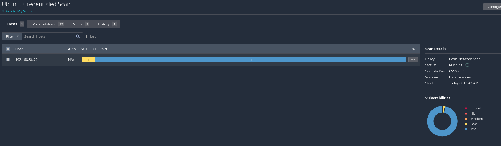
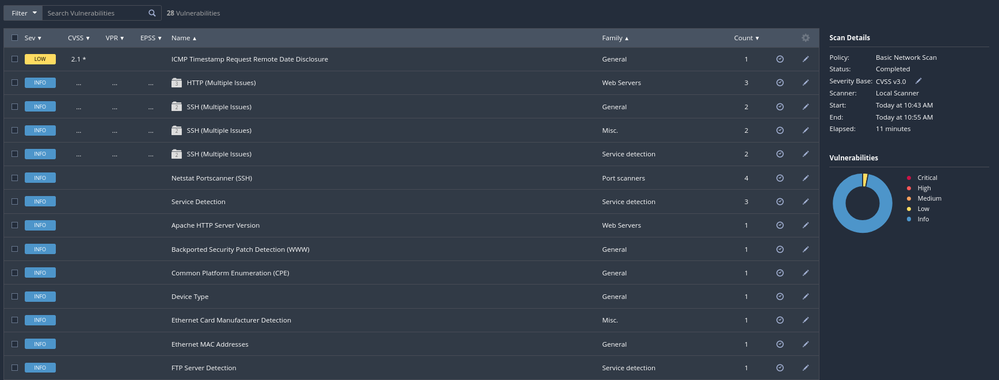
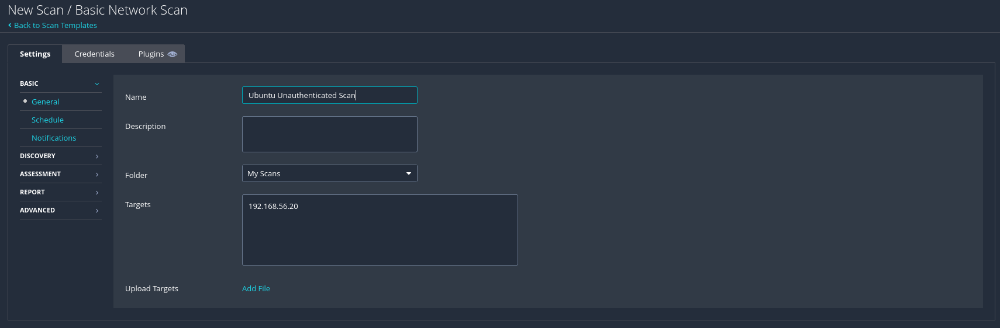
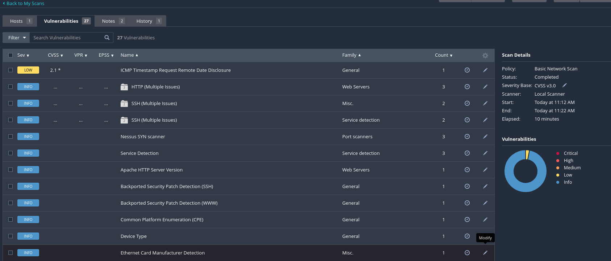
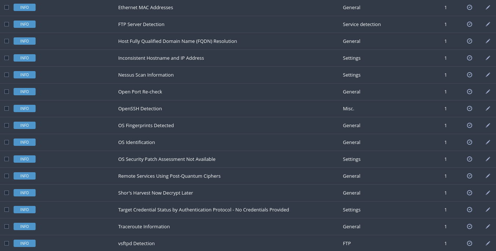

# 1. Credentialed Scan & Local System Audit

**Objective:** Discover the vulnerabilities that a network-only scan completely misses.

## Background

In Task 0, I ran an unauthenticated Web Application Tests scan against DVWA. A credentialed scan goes further — Nessus logs into the target host using valid credentials and inspects it from the inside, identifying missing patches, weak configurations, and locally installed software vulnerabilities that are invisible to a network-only scanner.

**Learning Goal:** Understand why credentialed scans are considered the gold standard for accurate vulnerability assessment, and be able to configure, execute, and interpret one end-to-end.

---

## 1.1 - Lab Environment Setup

| Option | OS | IP | Credentials |
|--------|----|----|-------------|
| **A (selected)** | Ubuntu Server 22.04/24.04 | 192.168.56.20 | user / user |
| B | Metasploitable 2 | 192.168.56.3 | msfadmin / msfadmin |

**Authorized Targets:** only the lab VMs (`192.168.56.20` / `192.168.56.3`) were scanned — they belong to me, so no external authorization is needed.

### Student Details

| Field | Your Answer |
|-------|-------------|
| Selected Target | Ubuntu Server — 192.168.56.20 |
| Target IP Address | 192.168.56.20 |
| Nessus Version | Nessus Essentials 10.12.5 |

### Pre-Lab Checklist

- [x] Nessus Essentials is installed and activated
- [x] Target VM is powered on and reachable (ping test passes)
- [x] You have valid credentials for the target (SSH: user / user)
- [x] Nessus and the target VM are on the same host-only adapter (192.168.56.0/24)
- [x] You have noted the target IP address

**Screenshot required: Ping test result confirming the target VM is reachable**

> The ping succeeded (0% loss) and an SSH login as `user` confirmed the credentials work. The SSH banner also reported *"278 updates can be applied immediately, 217 of these are standard security updates"* — useful context for the credentialed scan.

---

## 1.2 - Configuring Credentials in Nessus

**Steps**

1. Create a new **Basic Network Scan** and open the **Credentials** tab.
2. Choose credential type: **SSH** (the target is a Linux system).
3. Enter the username and password.
4. Save and attach the credentials to the scan.

**Screenshot required: Nessus credential configuration screen with type and username filled in**

### Credential Configuration Record

| Field | Your Entry |
|-------|-----------|
| Credential Type | SSH |
| Username | user |
| Authentication Method | Password |
| Target IP | 192.168.56.20 |
| Credential Verification | **Yes** — Nessus confirmed authentication (see 1.5) |

> Nessus confirmed the login worked. The finding *"Target Credential Status by Authentication Protocol – Valid Credentials Provided"* (plugin 141118) shows: `User: 'user', Port: 22, Proto: SSH`.

---

## 1.3 - Scan Configuration & Execution

Used the **Basic Network Scan** template with SSH credentials attached.

**Screenshot required: Scan settings page showing target IP, template, and credentials tab**

**Screenshot required: Scan progress / completion screen**

### Scan Metrics (credentialed scan)

| Metric | Value |
|--------|-------|
| Scan Start Time | 10:43 |
| Scan End Time | 10:55 |
| Total Duration | 11 minutes |
| Total Plugins Executed | See "Nessus Scan Information" finding (full Basic Network Scan plugin set) |
| Hosts Scanned | 1 |

---

## 1.4 - Results Analysis - Credentialed vs Unauthenticated

Both scans used the **Basic Network Scan** template against the **same host** (`192.168.56.20`). The only difference: the first had SSH credentials attached, the second had none.

| Severity | Credentialed Scan | Unauthenticated Scan |
|----------|-------------------|----------------------|
| Critical | 0 | 0 |
| High | 0 | 0 |
| Medium | 0 | 0 |
| Low | 1 | 1 |
| Info | 27 | 26 |
| **TOTAL** | **28** | **27** |

**Screenshot required: Nessus results summary for the credentialed scan** — see `img/05-cred-results-summary.png` above.

**Unauthenticated scan (for comparison):**

> **Note on severities:** No Critical/High/Medium appeared in either scan. The target is current at the package level Nessus audits, and most of the "217 updates" are Ubuntu ESM / phased updates that Nessus does not flag as standard vulnerabilities. The value of the credentialed scan here is **depth and local visibility**, not raw severity counts.

### 3 vulnerabilities that appeared ONLY in the credentialed scan

| # | Finding (credentialed only) | Why it was hidden from the unauthenticated scan |
|---|------------------------------|--------------------------------------------------|
| 1 | **Netstat Portscanner (SSH)** | Enumerates open ports by reading the host's own `netstat` output over SSH. Without a login, Nessus cannot run local commands, so it fell back to the network-based "Nessus SYN scanner" in the unauthenticated scan. |
| 2 | **Netstat Connection Information** | Lists the host's active network connections, read locally via the SSH session. Requires shell access, which the unauthenticated scan never had. |
| 3 | **Target Credential Status – Valid Credentials Provided** | Only produced when Nessus successfully authenticates. The unauthenticated scan instead reported *"Target Credential Status – No Credentials Provided."* |

> **The clearest proof of the difference:** the **unauthenticated** scan produced two findings the credentialed scan did not — *"OS Security Patch Assessment Not Available"* and *"No Credentials Provided."* In other words, without a login Nessus openly reports that it **could not assess local patches at all**. That is exactly the gap a credentialed scan closes.

---

## 1.5 - Deep Dive - One Local Vulnerability

The only severity-rated finding in the credentialed scan was the ICMP Timestamp disclosure (the rest were informational).

| Field | Detail |
|-------|--------|
| Plugin Name | ICMP Timestamp Request Remote Date Disclosure |
| CVE ID | CVE-1999-0524 |
| Severity / CVSS | Low / 2.1 |
| Plugin Family | General |
| Plugin ID | 10114 |
| Plugin Output (summary) | The remote host answers ICMP timestamp requests, allowing its system clock / date to be read remotely. |
| Root Cause | Misconfiguration — the host responds to ICMP timestamp (type 13) requests. |
| Potential Impact | The disclosed time can help an attacker fingerprint the host and defeat time-based authentication or anti-replay protocols. |
| Remediation Steps | Filter out ICMP timestamp requests (type 13) and timestamp replies (type 14) at the host firewall, e.g. on Linux: `sudo iptables -A INPUT -p icmp --icmp-type timestamp-request -j DROP` and `--icmp-type timestamp-reply -j DROP`. |

**Screenshot required: Nessus finding detail page for your chosen vulnerability**

> _TODO: add `img/task1/10-icmp-timestamp-detail.png` — in the credentialed scan's Vulnerabilities tab, click **"ICMP Timestamp Request Remote Date Disclosure"** and screenshot its detail page._

---

## 1.6 - Reflection Questions

**Q1. Why should organisations always prioritise credentialed scanning over unauthenticated scanning for internal systems?**

A credentialed scan logs into the host and inspects it from the inside, so it can read the exact installed package versions, patch levels, and local configuration. This gives far more accurate results with fewer false negatives — an unauthenticated scan can only guess from what services expose to the network, and (as this lab showed) it openly reports that it cannot even assess local patches. For internal systems, where the goal is to find and fix real weaknesses before attackers do, the deeper and more reliable visibility of a credentialed scan makes it the gold standard.

**Q2. What security risks exist in storing scan credentials inside a vulnerability scanner? How would you mitigate these risks?**

The scanner becomes a high-value target: if it is compromised, an attacker inherits working credentials to every host those credentials cover — effectively a master key to the estate. Mitigations include using dedicated, least-privilege scan accounts (read-only where possible rather than root/admin), storing credentials in a secrets manager or vault rather than in plain policy files, rotating the credentials regularly, restricting and monitoring access to the scanner, segmenting it on the network, and using SSH key-based authentication with per-host known_hosts rather than reusable passwords.

**Q3. How would you handle a situation where a credentialed scan is not possible on certain hosts (e.g. legacy systems, locked accounts)?**

Where a credentialed scan is not possible, I would fall back to an unauthenticated scan for whatever visibility it provides and compensate with other controls: agent-based scanning (an installed agent reports local data without remote login), manual audits or configuration reviews of those hosts, tighter network segmentation and monitoring around them, and prioritising their eventual replacement or remediation. I would also document the gap clearly in the report so stakeholders know those hosts were only partially assessed.

---

## Deliverables Checklist

- [x] Completed task document with all placeholder fields filled in
- [x] All required screenshots embedded and clearly labeled
- [x] Credentialed vs unauthenticated comparison table completed
- [x] One vulnerability deep-dive table completed
- [ ] Exported Nessus scan report (PDF or HTML) submitted separately — _export the credentialed scan report and submit it_
- [x] All reflection questions answered in full sentences

> **Still to do before submitting:** (1) add the ICMP Timestamp detail screenshot for 1.5, and (2) export the credentialed scan's report (Report / Export → PDF or HTML) and submit it alongside this document.

---

## Reference — CVSS Severity Scale

| Severity | Score Range | Priority |
|----------|-------------|----------|
| Critical | 9.0 – 10.0 | Immediate (24–72 hours) |
| High | 7.0 – 8.9 | Urgent (within 7 days) |
| Medium | 4.0 – 6.9 | Planned (within 30 days) |
| Low | 0.1 – 3.9 | Scheduled (within 90 days) |
| Informational | 0.0 | No action required |
