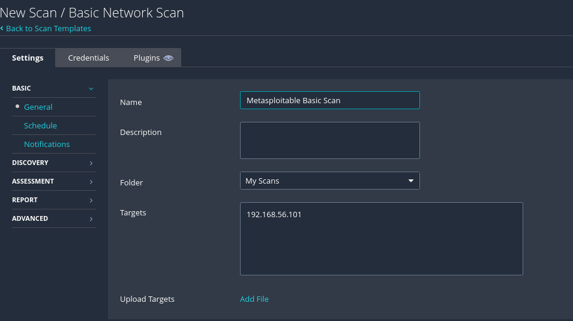
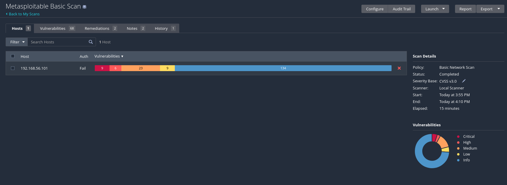
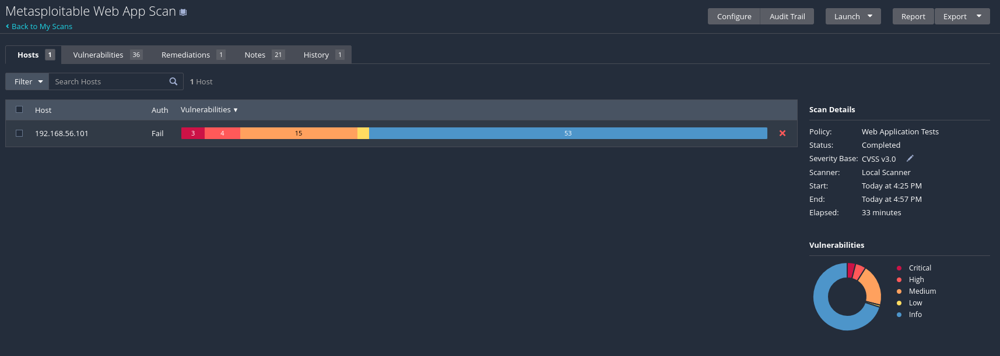
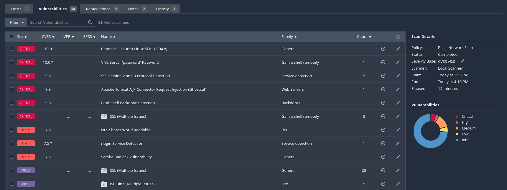
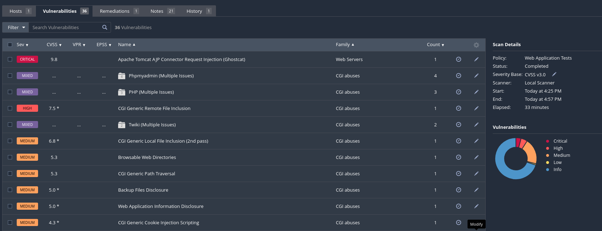
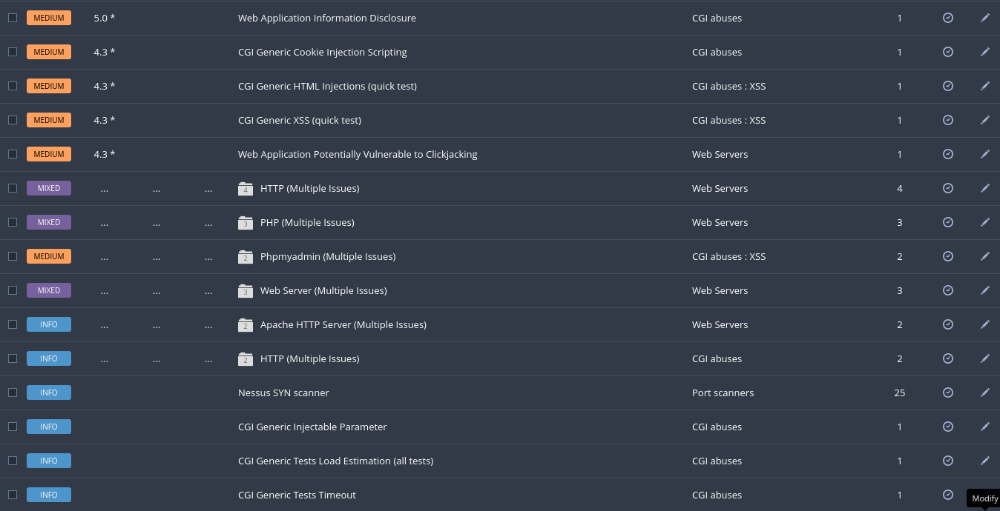
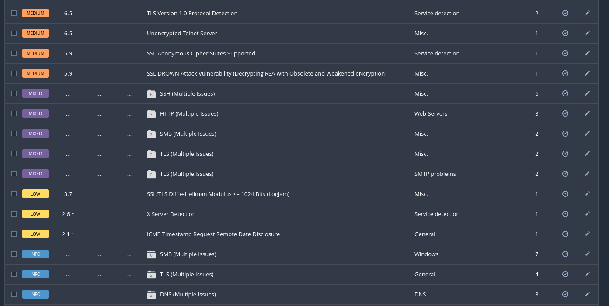

# 2. Comparative Analysis - Nessus Basic vs Nessus Web Application Tests

**Objective:** Compare two Nessus scan templates on the same target and analyze the differences in results.

## Background

Two Nessus scan templates can produce significantly different results on the same target. In this task I ran both a **Basic Network Scan** and a **Web Application Tests** scan on Metasploitable 2, then compared the results in terms of coverage, depth, types of findings, and scan duration.

**Learning Goal:** Understand how the choice of a Nessus template directly impacts scan results — a critical skill for adapting a scanning approach to different environments.

> **Note on target IP:** the task sheet lists Metasploitable as `192.168.56.3`; in my VirtualBox lab DHCP assigned it **`192.168.56.101`**, which is the address used throughout.

---

## 3.1 Environment & Scan Configuration

Both scans use **Nessus Essentials** — no additional tools are required.

| Field | Your Input |
|-------|-----------|
| Nessus Version | Nessus Essentials 10.12.5 |
| Common Target | Metasploitable 2 — 192.168.56.101 |
| Scan A - Template | Basic Network Scan (unauthenticated) |
| Scan B - Template | Web Application Tests |
| Port Range (both scans) | default |

Both scans were run in the same session. Start/end times were recorded for each.

**Screenshots required: Basic Network Scan results · Web Application Tests results**

---

## 3.2 Side-by-Side Results Comparison

| Metric | Basic Network Scan | Web Application Tests |
|--------|--------------------|-----------------------|
| Scan Duration | 15 min (15:55 → 16:10) | 33 min (16:25 → 16:57) |
| Critical Findings | 9 | 3 |
| High Findings | 6 | 4 |
| Medium Findings | 23 | 15 |
| Low Findings | 9 | 1 |
| Informational | 134 | 53 |
| Total Findings | 181 instances (68 distinct plugins) | 76 instances (36 distinct plugins) |
| CVEs with CVSSv3 Scores | ~47 severity-rated findings | ~23 severity-rated findings |
| Unique Findings | Network/service vulnerabilities (see 3.3) | Web/CGI vulnerabilities (see 3.3) |
| False Positives | ~0 (Metasploitable really is this vulnerable) | A few "CGI Generic" probes may need manual confirmation |

> The "severity counts" are read from each scan's host severity bar; "distinct plugins" is the number shown on the Vulnerabilities tab. Metasploitable is intentionally vulnerable, so the Basic scan's Critical/High findings are genuine (very low false-positive rate). The Web App template's generic CGI tests are the ones most worth verifying by hand.

**Basic Network Scan — critical/high findings:**

**Web Application Tests — critical/high findings:**

---

## 3.3 Analysis of Unique Findings

| Template | Finding Name / CVE | Severity | Why it was missed by the other scan |
|----------|--------------------|----------|-------------------------------------|
| Basic Network Scan only | VNC Server 'password' Password | Critical (10.0) | Web App Tests only probes HTTP services; it never tests the VNC service on port 5900. |
| Basic Network Scan only | Bind Shell Backdoor Detection | Critical (9.8) | A backdoor listening on a non-web port (1524). The Web App template does not probe non-HTTP ports. |
| Basic Network Scan only | Samba Badlock Vulnerability | High (7.5) | An SMB/Samba flaw (ports 139/445). SMB is not a web protocol, so the Web App template never checks it. |
| Web Application Tests only | CGI Generic Remote File Inclusion | High (7.5) | Found only by actively fuzzing web-app parameters — a depth of web testing the Basic template does not perform. |
| Web Application Tests only | CGI Generic Path Traversal / Local File Inclusion | Medium (5.3 / 6.8) | Requires crawling and manipulating web parameters; the Basic scan only fingerprints the web server, it does not fuzz it. |
| Web Application Tests only | CGI Generic XSS / HTML Injection (quick test) | Medium (4.3) | Cross-site-scripting tests are part of the web-app methodology, absent from the Basic network template. |

> **Shared finding worth noting:** *Apache Tomcat AJP Connector Request Injection (Ghostcat, CVE-2020-1938, Critical 9.8)* appeared in **both** scans — it sits on the HTTP/AJP stack that both templates examine. Everything else diverged along network-vs-web lines.

**Why the split happens:** the Basic-only findings live on non-HTTP services (VNC, SMB, NFS, Telnet, rlogin, backdoor ports) that the Web App template never touches. The Web-App-only findings are discovered only by actively crawling and fuzzing the web applications Metasploitable hosts (Mutillidae, DVWA, phpMyAdmin, TWiki) — something the Basic template does lightly, if at all.

**Web Application Tests — medium findings (web-specific):**

**Basic Network Scan — medium/low/info findings (network-specific):**

---

## 3.4 Template Comparison

| Criteria | Basic Network Scan | Web Application Tests | Notes |
|----------|--------------------|-----------------------|-------|
| Scan Duration | 15 min | 33 min | The Web App scan is slower because it crawls and fuzzes every web app. |
| Types of Vulnerabilities | Network / Services | Web / HTTP | |
| Plugins Used | Network, ports, services | HTTP, forms, cookies, CGI | |
| Credentials Required | No | No | Both scans were unauthenticated. |
| Web Analysis Depth | Low | High | The Web App scan found CGI/XSS/LFI issues the Basic scan missed entirely. |
| Total Findings | 181 (68 distinct) | 76 (36 distinct) | |
| False Positive Rate | ~0% | Low (verify generic CGI tests) | |

> **Takeaway:** the Basic Network Scan gives **breadth** across every service on the host (and caught the most severe issues here — VNC password, backdoor, Samba). The Web Application Tests scan gives **depth** on the websites, surfacing injection/traversal/XSS issues the Basic scan cannot see. A thorough assessment of a host like this needs **both** templates.

---

## Deliverables Checklist

- [x] Both scans executed against Metasploitable 2 (192.168.56.101)
- [x] Results comparison table completed
- [x] Unique findings analysis completed
- [x] Template comparison completed
- [ ] Both Nessus reports exported (PDF/HTML) — _export both scans' reports and submit them separately_

> **Still to do before submitting:** export each scan's report (Report / Export → PDF or HTML) and submit the two files alongside this document.
