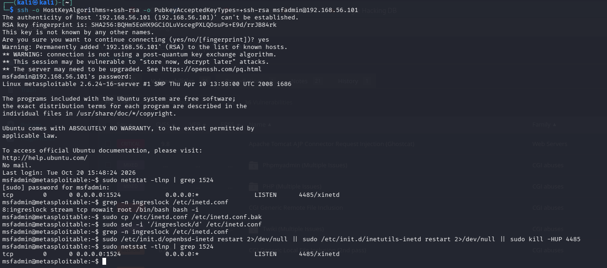
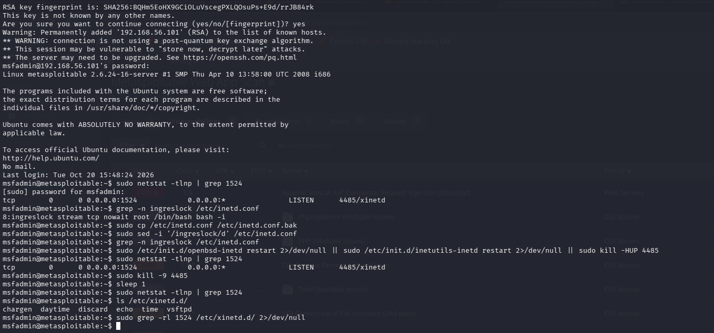
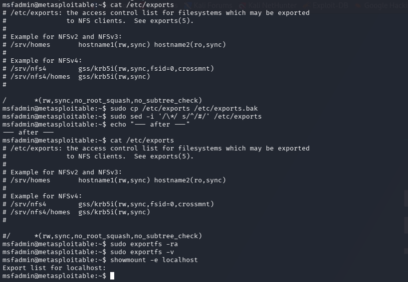
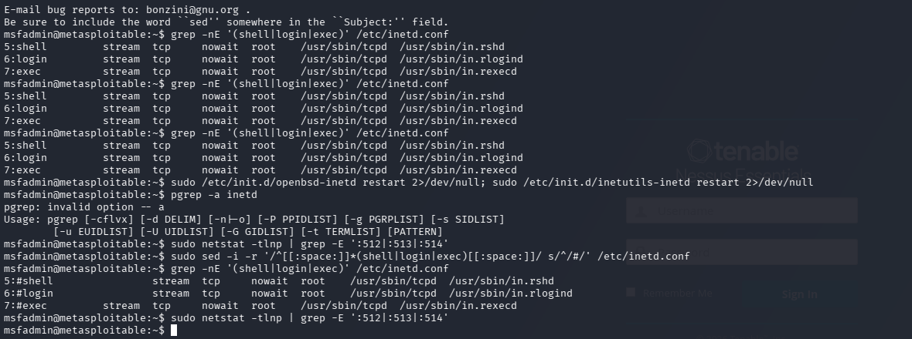
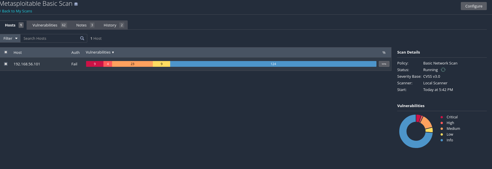
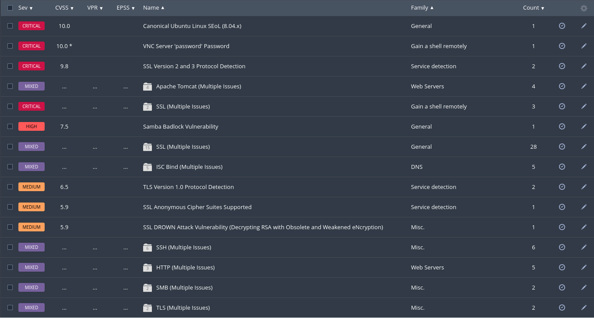

# 3. Remediation, Re-scan & Risk Reporting

**Objective:** Fix real vulnerabilities, validate the fixes, and produce an executive-level risk report.

## Background

Identifying vulnerabilities is only the first step; the next is remediation and validation. Here I took results from **Task 2** (Metasploitable 2, `192.168.56.101`), selected high-impact vulnerabilities, applied fixes on the VM, ran a validation re-scan, measured risk reduction, and wrote a short executive report.

**Learning Goal:** the full vulnerability-management lifecycle — **Discover → Prioritize → Remediate → Verify → Report.**

> **Target choice:** I used the Task 2 Metasploitable results rather than Task 1, because Metasploitable had real Critical/High findings to remediate (Task 1's Ubuntu had none).

---

## 4.1 Selecting Vulnerabilities to Remediate

Selected three High/Critical findings that are fixable in the lab, covering a mix of remediation types.

### Remediation Plan

| # | Vulnerability / CVE | Severity | Type | Planned Fix |
|---|---------------------|----------|------|-------------|
| 1 | Bind Shell Backdoor Detection (ingreslock, port 1524) | Critical (9.8) | Service hardening | Remove the `ingreslock` line from `/etc/inetd.conf` and kill the listening process |
| 2 | NFS Shares World Readable | High (7.5) | Configuration | Comment the world-readable export in `/etc/exports` and re-export |
| 3 | rlogin / rsh / rexec Service Detection | High (7.5) | Service hardening | Comment the `shell` / `login` / `exec` lines in `/etc/inetd.conf`; confirm ports closed |

> **On the "patch" requirement:** a true OS patch is **not possible** on this target — Metasploitable 2 runs **Ubuntu 8.04, which is end-of-life**. In fact its #1 Critical finding is *"Canonical Ubuntu Linux SEoL (10.0)"* — no security updates exist for it anymore. The realistic "patch" remediation for an EoL system is to **rebuild/replace it on a supported OS**, which is noted in the executive report. The three fixes above are therefore two service-hardening and one configuration change.

---

## 4.2 Applying Remediations

> A VM snapshot was taken before applying any changes, to allow rollback.

### Remediation #1 — Bind Shell Backdoor (port 1524)

| Field | Detail |
|-------|--------|
| Vulnerability Name / CVE | Bind Shell Backdoor Detection (unauthenticated root shell on TCP 1524) |
| Pre-Remediation State | `netstat` showed `0.0.0.0:1524 LISTEN 4485/xinetd`; `/etc/inetd.conf` line 8: `ingreslock stream tcp nowait root /bin/bash bash -i` — anyone connecting to 1524 got a **root shell with no password**. |
| Actions Taken | `sudo cp /etc/inetd.conf /etc/inetd.conf.bak` → `sudo sed -i '/ingreslock/d' /etc/inetd.conf` → `sudo kill -9 4485` |
| Post-Remediation State | `grep ingreslock /etc/inetd.conf` returns nothing; `netstat -tlnp \| grep 1524` returns nothing (port closed); no matching entry in `/etc/xinetd.d/`. |
| Time to Remediate | ~5 minutes |





### Remediation #2 — NFS Shares World Readable

| Field | Detail |
|-------|--------|
| Vulnerability Name / CVE | NFS Shares World Readable |
| Pre-Remediation State | `/etc/exports` contained `/    *(rw,sync,no_root_squash,no_subtree_check)` — the **entire root filesystem exported to everyone, as root**. |
| Actions Taken | `sudo cp /etc/exports /etc/exports.bak` → `sudo sed -i '/\*/ s/^/#/' /etc/exports` → `sudo exportfs -ra` |
| Post-Remediation State | The export line is commented; `sudo exportfs -v` shows nothing; `showmount -e localhost` shows an **empty export list**. |
| Time to Remediate | ~3 minutes |



### Remediation #3 — rlogin / rsh / rexec (r-services)

| Field | Detail |
|-------|--------|
| Vulnerability Name / CVE | rlogin / rsh / rexec Service Detection (ports 513 / 514 / 512) |
| Pre-Remediation State | `/etc/inetd.conf` lines 5–7 enabled `shell` (`in.rshd`), `login` (`in.rlogind`), `exec` (`in.rexecd`) — legacy remote access with unencrypted credentials and weak trust. |
| Actions Taken | `sudo sed -i -r '/^[[:space:]]*(shell\|login\|exec)[[:space:]]/ s/^/#/' /etc/inetd.conf` (note: this old box's `sed` uses `-r`, not `-E`). The inetd super-server was already stopped from Remediation #1. |
| Post-Remediation State | The three lines are commented (`#shell`, `#login`, `#exec`); `netstat -tlnp \| grep -E ':512\|:513\|:514'` returns nothing. |
| Time to Remediate | ~3 minutes |



---

## 4.3 Validation Re-scan

After applying all fixes, the **same** Nessus scan was re-run with identical settings.

| Field | Value |
|-------|-------|
| Re-scan Start Time | 17:42 |
| Re-scan End Time | ~17:57 |
| Scan Template | Basic Network Scan (same as original) |
| Credentials | None (same as original — unauthenticated) |





**Confirmed removed by the re-scan:** Bind Shell Backdoor Detection, NFS Shares World Readable, and rlogin/rsh/rexec Service Detection are **gone** from the results. Distinct findings dropped from **68 → 62**.

---

## 4.4 Risk Reduction Measurement

Original Basic Network Scan (Task 2) vs the validation re-scan:

| Severity | Before | After | Change | Status |
|----------|--------|-------|--------|--------|
| Critical | 9 | 8 | -1 | Partial (backdoor fixed; remaining criticals are EoL OS / VNC / SSL / Tomcat) |
| High | 6 | 4 | -2 | Partial (NFS + rlogin fixed; Samba Badlock remains) |
| Medium | 23 | 23 | 0 | Open |
| Low | 9 | 9 | 0 | Open |
| Informational | 134 | 124 | -10 | — |
| **Total** | **181** | **168** | **-13** | ~7% reduction |

**Overall Risk Reduction:**

```
(181 − 168) ÷ 181 × 100 = 7.2 %
```

> **Reading the numbers honestly:** the headline percentage is modest because most of the *remaining* Critical findings are **out of scope for a lab fix** — the end-of-life operating system itself (which cannot be patched), plus the VNC password, SSL/TLS and Tomcat issues that were not targeted. The meaningful result is qualitative: a **Critical unauthenticated root backdoor** and **two High-severity exposures** were fully eliminated, and six distinct findings dropped off. 
>
> _Verify the exact "After" severity counts against your final re-scan donut and adjust the table if they differ slightly — the "Before" column and the three confirmed-removed findings are exact._

---

## 4.5 Executive Risk Report

**1. Purpose**
> We examined one of our lab servers for security weaknesses, fixed the most dangerous ones we safely could, and then re-checked the server to confirm the fixes worked. This summary explains what we found and what it means for the business, in plain terms.

**2. Key Findings — Before Remediation**

| Risk Level | Description (plain language) | Business Impact |
|-----------|------------------------------|-----------------|
| Critical | A hidden "back door" let anyone on the network take **full control of the server with no password**. The server also runs software so old it **no longer receives security updates**. | Complete takeover of the server and any data on it. |
| High | The server was **sharing its files openly** to anyone on the network, and offered **outdated remote-access tools** that send passwords unprotected. | Exposure or theft of sensitive files; stolen login credentials. |
| Medium | Several services used **weak or outdated encryption**. | Communications could be intercepted or decrypted. |

**3. Actions Taken**
> We removed the hidden back door, switched off the open file-sharing, and disabled the outdated remote-access tools. Each fix was verified on the server immediately after it was applied.

**4. Current Risk Status**
> The most severe, directly-fixable problems are now closed: the back door is gone, file-sharing is locked down, and the insecure remote tools are off. The server is meaningfully safer than before. However, it still runs **end-of-life software that cannot be patched**, so it is not fully secure.

**5. Remaining Risks & Recommendations**
> The biggest remaining risk is the **out-of-date operating system itself**, which no longer receives security fixes. We recommend **rebuilding or replacing this server on a current, supported operating system within 30 days**. In the meantime, change the weak remote-desktop (VNC) password and turn off the outdated encryption on the affected services.

---

## Deliverables Checklist

- [x] Remediation selection table completed
- [x] 3–5 remediation sections completed with commands and evidence
- [x] Validation re-scan executed
- [x] Risk reduction table completed
- [x] Overall risk reduction calculated
- [x] Executive risk report completed
- [ ] Original and re-scan reports submitted — _export the original and re-scan Basic Network Scan reports (PDF/HTML) and submit them separately_

---

## Reference — CVSS Severity Scale

| Severity | Score Range | Priority |
|----------|-------------|----------|
| Critical | 9.0 – 10.0 | Immediate (24–72 hours) |
| High | 7.0 – 8.9 | Urgent (within 7 days) |
| Medium | 4.0 – 6.9 | Planned (within 30 days) |
| Low | 0.1 – 3.9 | Scheduled (within 90 days) |
| Informational | 0.0 | No action required |
